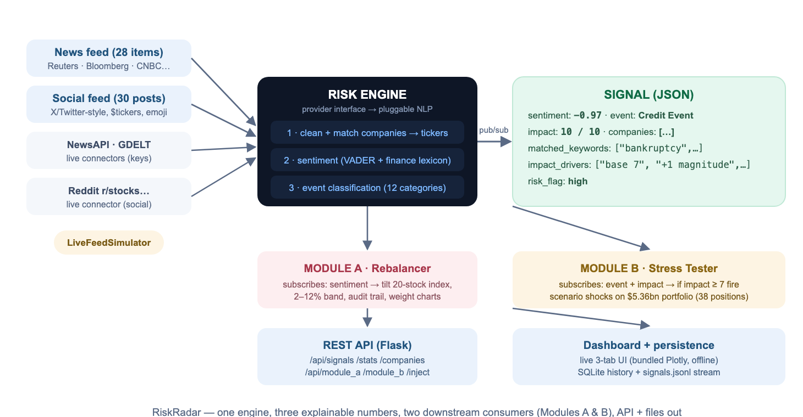

# RiskRadar — S&P Global & Crisil Campus Hackathon

**Candidate Name:** Aare Renu Shri
**College Email ID:** cs24btech11001@iith.ac.in
**College / Campus:** Indian Institute of Technology, Hyderabad
**Demo Video Link:** [YouTube — unlisted. Will be added here after recording.]
**Slide Deck Link (if hosted externally):** Hosted in this repo → [`docs/presentation.pdf`](docs/presentation.pdf)

---

## 1. Project Overview / Problem Statement & Approach

**The problem.** Markets move on news — earnings, sanctions, bankruptcies, product launches — but risk systems only consume numbers. The case study asks for a platform that ingests real-time, unstructured text (news + social media) and converts it into **actionable, structured financial risk signals**, then feeds at least one downstream module that acts on those signals.

**The approach.** RiskRadar is a single Python process built around a publish/subscribe core. The **AI/NLP Risk Engine** ingests two source types (a financial news feed and a social-media feed, with optional live connectors for NewsAPI, GDELT and Reddit that fail soft), and for every item outputs a machine-readable signal: **sentiment score (−1 to +1)** via a finance-tuned VADER lexicon, **event classification** across 12 categories via priority-ordered rules, and an **impact score (1–10)** via a transparent formula. Crucially, every signal carries its own evidence — the keywords that drove the classification and the drivers that drove the impact score — because a risk number that cannot answer *"why?"* is worthless. Signals are published through a REST API and written to `signals.jsonl` + SQLite.

**Both downstream modules were built.** **Module A (tactical):** a rebalancer that subscribes to sentiment and dynamically tilts a 20-stock mock index (S&P 100 subset) — `w_new = w_old × (1 + 0.25 × sentiment)`, weights clamped to 2–12% and renormalized — with a full audit trail of every weight change. **Module B (strategic):** a stress tester that subscribes to event classification + impact; whenever an event lands with **impact ≥ 7**, it fires an event-typed shock scenario (e.g. rates +200bp, equity −10%, credit spreads +250bp) over a **$5.36bn synthetic wholesale banking portfolio** (38 positions, 9 asset classes) and reports before/after valuation, P&L by asset class and worst-hit positions. A live 3-tab dashboard visualizes everything — and includes a box where **any headline can be typed and analyzed in real time** in front of the jury.

## 2. Architecture & Tech Stack



**Data flow (one direction, no hidden magic):** sources (threads) → engine (clean → company/ticker matching → sentiment → event classification → impact) → `Signal` (JSON with evidence) → store (SQLite + JSONL) → subscribers (Module A, Module B) + REST API → live dashboard.

**Why this shape:** the pub/sub core decouples producers from consumers — the modules never talk to the sources and the engine doesn't know who listens, which is why Module B was a ~150-line addition after Module A. The NLP sits behind a one-method provider interface, so swapping the lexicon engine for FinBERT or an LLM later is a one-file change. Live connectors **fail soft** (no key / no network → engine logs it and carries on with the built-in feed simulator), so the demo can never break.

**Tech stack:** Python 3.9+ · VADER (`vaderSentiment`) extended with a ~150-term finance lexicon · priority-rule event classifier · Flask (REST API) · SQLite + JSONL persistence · vanilla JS + **vendored Plotly** (`dashboard/plotly.min.js` is committed deliberately so the dashboard works fully offline) · threading for sources (no external broker needed).

**Repository structure:**
```
├── README.md            ← this file
├── LICENSE              ← MIT
├── requirements.txt     ← dependencies
├── run.py               ← entry point: API + dashboard + live engine
├── demo.py              ← headless end-to-end run (also generates figures)
├── src/
│   ├── engine/          ← models, lexicon, classifier, impact, ingest, pub/sub pipeline, store
│   ├── modules/         ← module A (rebalancer) + module B (stress tester)
│   └── api/             ← Flask REST API
├── data/                ← all datasets used (see §3)
├── dashboard/          ← single-page live dashboard (offline Plotly)
└── docs/
    ├── presentation.pdf ← 7-slide deck
    ├── architecture.png ← diagram above
    └── Project_Report_and_QA.pdf  ← detailed write-up (bonus supporting doc)
```

## 3. Dataset Used

| File | What it is | Nature |
|---|---|---|
| `data/news_sample.jsonl` | 28 financial news headlines spanning every event category | **Synthetic** — hand-authored, realistic Reuters/Bloomberg/CNBC/FT-style items, clearly labeled as sample data |
| `data/social_sample.jsonl` | 30 X/Twitter-style posts ($tickers, emoji, slang, negation) | **Synthetic** — hand-authored to stress-test social-media sentiment |
| `data/portfolio.csv` | Wholesale banking portfolio: 38 positions, 9 asset classes (corporate loans, CRE, government bonds, IG/HY credit, MBS, derivatives, commitments, equity), $5.36bn | **Synthetic** — hand-constructed to the case study's spec (loans + bonds + derivatives) with plausible fields (rating, duration, spread, direction) |
| `demo_outputs/signals.json` | The full structured output of the headless demo run | Generated by `python demo.py` |

**Optional live sources (real connectors, keys/network required):** NewsAPI (newsapi.org free tier, `NEWSAPI_KEY` env var), GDELT DOC 2.0 API (no key), Reddit public JSON (r/wallstreetbets, r/stocks). These activate only when available and fail soft otherwise.

**Assumptions:** (1) bundled items are realistic samples standing in for live feeds so the demo is reproducible offline; (2) portfolio valuations are notional-based (simplified first-order risk, as the case study permits); (3) **no proprietary or confidential data is used anywhere** — all data is self-authored or from the free public APIs listed above.

## 4. Quickstart & Installation

Runtime: **Python 3.9+** (tested on Python 3.14, macOS; no GPU, no internet, no API keys required).

```bash
git clone https://github.com/AareRenuShri/iith-aare-renu-shri-hackathon.git
cd iith-aare-renu-shri-hackathon
python -m venv .venv && source .venv/bin/activate   # Windows: .venv\Scripts\activate
pip install -r requirements.txt
python run.py        # → dashboard opens at http://localhost:8000
```

The engine boots with a live-feed simulator streaming the bundled news + social items; everything (engine, both modules, API, dashboard) runs in that one command. Other entry points:

```bash
python run.py --offline   # bundled feeds only (safest demo mode)
python run.py --fast      # faster feed for a quick walkthrough
python demo.py            # headless end-to-end run; prints results, writes demo_outputs/
```

## 5. Key Results & Domain Impact

**What the prototype outputs.** Every processed item becomes a structured signal, e.g. (real output): *"OPEC+ surprise production cut escalates trade tensions"* → sentiment **−0.84**, event **Geopolitical**, impact **8.5** with stored evidence (`["base 6.5 (Geopolitical)", "+1 urgency", "+1 strongly negative"]`).

| Metric (headless run, `python demo.py`) | Result |
|---|---|
| Items processed (news + social) | 58 (28 + 30) |
| Meaningfully classified | 54/58 (**93%**), 4 honest "Other" |
| Per-signal latency | **0.3 ms** median (~3,300 signals/sec on one core) |
| Module A weight changes | 45 (top: MCD 7.4%, WMT 7.3% · bottom: KO 2.6%, BAC 2.6% — started equal at 5%) |
| Module B stress tests fired | 23 (trigger: impact ≥ 7) |
| Worst stress loss | **−$435m (−8.1%)** rates shock (+200bp); credit shock −$355m (−6.6%) |

**Domain impact.** The same signals feed two very different consumers — a *tactical* index desk (rebalance now) and a *strategic* risk desk (stress the book) — mirroring workflows that today require separate tooling and expensive data contracts. Because every score carries its evidence, the output is auditable by design, which is the entry ticket for anything used in real risk management. Compared with a naive alternative (call a cloud NLP API per headline and trust a black-box score), this engine is ~1000× faster per item, needs zero infrastructure, works offline, and can always explain itself.

**Supporting material:** [`docs/presentation.pdf`](docs/presentation.pdf) (7 slides) · [`docs/Project_Report_and_QA.pdf`](docs/Project_Report_and_QA.pdf) (full design rationale, results, limitations and Q&A preparation) · [`DEMO_SCRIPT.md`](DEMO_SCRIPT.md) (video walkthrough + live pitch script).
